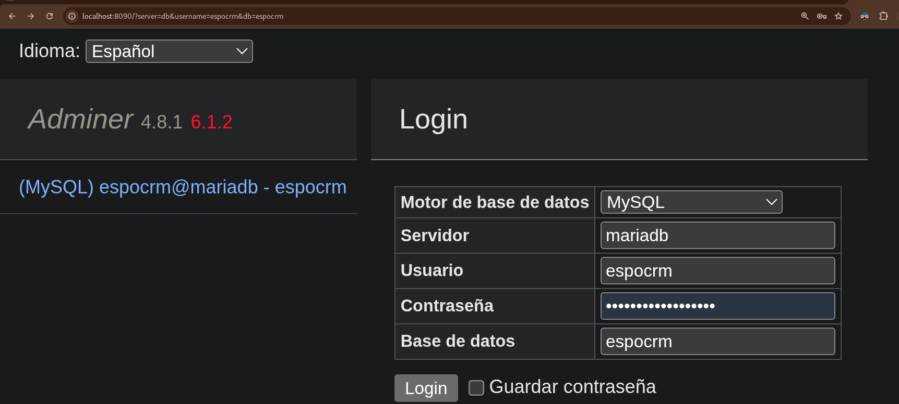

# Academia Erasmus+
## Martín Pereira - Martín Barreiro - Juan Martínez
## Como se levanta?
Para ello necesitaremos saber que servicios vamos a usar, para esta ocasión hemos elegido:
###### Base de datos --> MariaDB  
###### Aplicación --> EspoCRM  
###### Herramienta para observar la BD --> Adminer  
Necesitamos tener el Docker con el Compose instalado, procederemos entonces con la instalación de EspoCRM:

### 1. Accederemos a la carpeta donde se encuentra el compose:  
cd rutaHaciaElArchivoDeDocker

### 2. Se creará el fichero con todas las variables y se rellenarán las 3 contraseñas necesarias:

En el .env debería aparecer algo así solo que se ocultan las contraseñas ya que es un example:  
DB_ROOT_PASSWORD=  
DB_PASSWORD=  
ADMIN_PASSWORD=  

Esto se copiará al .env con el comando:  
###### cp .env.example .env

### 3. Con todo listo levantaremos la pila, lo que quiere decir que pondremos a funcionar los 3 servicios (mariadb, espocrm y adminer) con el siguiente comando:    
###### docker compose up -d

### 4. Comprobaremos que los servicios están levantados gracias al comando: 
###### docker compose ps 

### 5. Como últimos pasos accederemos a la aplicación con el enlace que nos entrega que en este caso es:  
###### http://localhost:8080 (usuario: "admin", password: ...)   

Y comprobaremos que todo funciona correctamente:  

### 6. Accederemos también al adminer con la siguiente URL:
###### http://localhost:8090 (usuario: espocrm, password:...) 

## Incidencias:  
Tuvimos una incidencia con el nombre del contenedor, daba un error  "Conflict", ya que existían contenedores anteriores con el mismo nombre.  
Se solucionó forzando su eliminación con docker rm -f y creando un archivo nuevo con ese nombre.  
  
Falló la descarga de Adminer porque la versión 4.8 no estaba, que era la que habíamos descargado.  
Se solucionó cambiando manualmente  de la versión 4.8 a la 4.8.1:  

